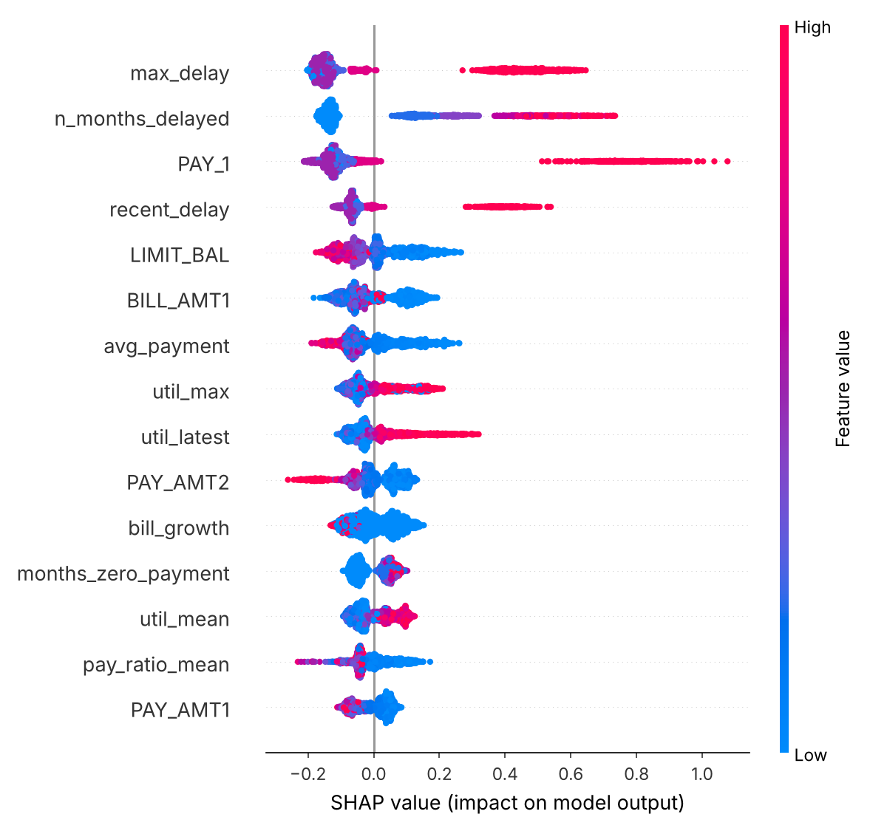

# Credit Default Risk: an end-to-end ML system

This project predicts whether a credit-card customer will default next month. It covers the whole lifecycle of a production model, from data to a deployed API. The pipeline:

- leakage-safe feature engineering
- six models compared under one cross-validation protocol
- Optuna tuning
- probability calibration
- a decision threshold chosen by business cost
- SHAP explanations
- a fairness audit
- PSI drift monitoring
- MLflow experiment tracking
- a FastAPI scoring service in Docker
- tests and CI

**Data:** [UCI "Default of Credit Card Clients"](https://archive.ics.uci.edu/dataset/350/default+of+credit+card+clients) (Yeh & Lien, 2009). It has 30,000 real customers, 23 features and a 22.1% default rate.

---

## Results (held-out test set, 6,000 customers, touched once)

| Model | ROC-AUC (95% CI) | PR-AUC | KS | Brier |
|---|---|---|---|---|
| Logistic regression, raw features (baseline) | 0.707 (0.689–0.725) | 0.494 | 0.368 | 0.147 |
| **Tuned LightGBM + engineered features + isotonic calibration** | **0.783 (0.768–0.798)** | **0.565** | **0.433** | **0.134** |

**Business view.** The assumption is that missing a defaulter costs 5× more than wrongly flagging a good customer. Each model's threshold is chosen on out-of-fold *training* predictions, never on the test set.

| Model @ its cost-optimal threshold | Threshold | Recall (defaulters caught) | Precision | Expected cost / customer |
|---|---|---|---|---|
| Baseline logistic regression | 0.23 | 59.5% | 38.7% | 0.656 |
| **Final model** | 0.19 | **67.0%** | **41.7%** | **0.572 (−12.8%)** |
| Final model at the default 0.5 threshold | 0.50 | 36.1% | 66.3% | 0.747 |

The default 0.5 threshold misses almost two-thirds of defaulters. Choosing the threshold by cost cuts expected loss by 23% with the *same* model.

### Cross-validation (5-fold, training set only)

| Experiment | ROC-AUC | PR-AUC | KS |
|---|---|---|---|
| Dummy (prior) | 0.500 | 0.221 | 0.000 |
| Logistic regression, raw features | 0.725 | 0.504 | 0.377 |
| Logistic regression, + engineered features | 0.758 | 0.508 | 0.414 |
| XGBoost (default) | 0.764 | 0.529 | 0.397 |
| LightGBM (default) | 0.780 | 0.555 | 0.421 |
| **LightGBM (Optuna, 30 trials)** | **0.788** | **0.565** | **0.439** |

Feature engineering alone adds +0.033 AUC to the linear model. All numbers come from `reports/results.json` and are reproduced with `make train`.

### What drives predictions (SHAP, `reports/figures/shap_summary.png`)

The top drivers are `max_delay`, `n_months_delayed` and the most recent repayment status (`PAY_1`), followed by credit limit and recent bill and payment amounts. Delinquency history dominates, which matches credit-risk domain knowledge.



### Fairness audit

`SEX` is a protected attribute. It is **excluded from the model** and kept only to audit outcomes (test set, cost threshold):

| Group | n | Actual default rate | Flag rate | TPR | FPR | AUC |
|---|---|---|---|---|---|---|
| Female | 3,598 | 21.3% | 34.5% | 66.6% | 25.8% | 0.786 |
| Male | 2,402 | 23.4% | 37.2% | 67.6% | 27.9% | 0.776 |

The gaps are 1.0 pt in TPR and 2.1 pts in FPR, roughly in line with the difference in base default rates.

### Drift monitoring (PSI)

`make drift` compares new data with the training distribution, feature by feature:

- **Real test set vs. train:** every PSI is below 0.003, so the population is stable.
- **Simulated stress scenario:** 30% of customers slip one month on repayments and carry 25% higher balances. This scenario is synthetic and labelled as such in the code. The monitor flags `n_months_delayed` (PSI 0.19) and `recent_delay` (0.11) as **watch**, while unaffected features stay stable.

---

## Engineering decisions

- **No leakage:** features are computed per row from the customer's own six months of history. The transform has no fitted state.
- **One protocol for every model:** a stratified 80/20 split with seed 42, then 5-fold stratified CV on the 80%. The test set is used exactly once.
- **Threshold chosen on out-of-fold predictions:** choosing it on the test set would overstate the gains.
- **Calibration:** isotonic regression, so `probability_of_default` can be used directly for pricing and limits.
- **Data quality:** the undocumented codes `EDUCATION ∈ {0,5,6}` and `MARRIAGE = 0` are merged into "others". `PAY_0` is renamed to `PAY_1` so the history columns line up. Schema assertions fail loudly.
- **Reproducibility:** the dataset is checksum-verified, all seeds are fixed, and every run is logged to MLflow (`sqlite:///mlflow.db`).

## Project layout

```
src/credit_risk/
  data.py       download (sha256-verified), cleaning, schema checks
  features.py   12 engineered features (delinquency, utilisation, repayment behaviour)
  train.py      experiments, Optuna tuning, calibration, threshold, test evaluation, MLflow
  metrics.py    ROC/PR-AUC, KS, Brier, cost threshold, bootstrap CI, per-group fairness
  explain.py    SHAP global importance + summary plot
  drift.py      PSI drift report
  serve.py      FastAPI service with pydantic validation
tests/          unit tests (features, metrics, PSI) + API tests
```

## Run it

```bash
pip install -r requirements.txt
make train      # ~5 min on a laptop CPU (Optuna 30 trials)
make explain
make drift
make test
make serve      # http://localhost:8000/docs
make mlflow-ui  # browse every run
```

Docker (serving only):

```bash
docker build -t credit-risk-api .
docker run -p 8000:8000 credit-risk-api
curl -X POST localhost:8000/predict -H "content-type: application/json" -d @examples/request.json
# {"probability_of_default":0.6341,"decision":"review","threshold":0.19,"model":"lightgbm_tuned","latency_ms":26.3}
```

Median in-process latency is about 31 ms per request on a 2-vCPU machine. That covers the 5-model calibrated ensemble plus feature computation.

## Limitations

- The data is from Taiwan (2005), so absolute default rates and patterns won't transfer to Indian lenders without retraining.
- The 5:1 cost ratio is an assumption. `COST_FN`/`COST_FP` in `config.py` should come from real loss-given-default and margin figures.
- The stress test is simulated. Real drift would also need monitoring of prediction distributions and of performance once labels arrive.
